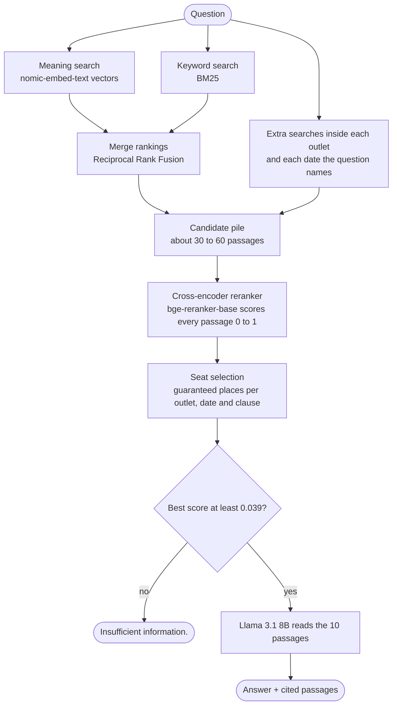

# Triangulate

**A fully local, multi-hop RAG system that answers questions by cross-checking facts across several news articles.**
No cloud, no API keys: everything runs on a 16 GB MacBook.


Most RAG demos answer questions whose answer sits in a single paragraph. Triangulate targets the harder case,
**multi-hop questions** such as *"Did The Verge and TechCrunch agree about X?"*, where the evidence is spread over two to four
articles from different outlets and dates. It is built and measured on the
[MultiHop-RAG](https://arxiv.org/abs/2401.15391) benchmark: 609 news articles and 2,556 questions with known answers and evidence.

```text
Question: Who is the individual associated with the cryptocurrency industry facing a criminal trial on fraud and
          conspiracy charges, as reported by both The Verge and TechCrunch, and is accused by prosecutors of
          committing fraud for personal gain?

  PASSAGES FOUND
   [1] score 0.982  The FTX trial is bigger than Sam Bankman-Fried               (The Verge, 2023-09-28)
   [2] score 0.945  Sam Bankman-Fried was a terrible boyfriend                    (The Verge, 2023-10-10)
   [5] score 0.777  SBF's trial starts soon, but how did he — and FTX — get here?  (TechCrunch, 2023-10-01)
   ...

  ANSWER
   Answer: Sam Bankman-Fried
   Explanation: [1] states that Sam Bankman-Fried is the founder of FTX and Alameda Research, and is facing seven
   counts of criminal charges. [2] also mentions that Sam Bankman-Fried is on trial for seven counts of wire fraud
   and conspiracy. ...
```
<sub>Real output from an earlier run of `ask.py` (abridged).</sub>

---

## Highlights

- **80% end-to-end accuracy** on a balanced 100-question sample of MultiHop-RAG (96% on "who/what" questions), with a local 8B model.
- **Says "Insufficient information." instead of inventing answers**: about 9 out of 10 unanswerable questions are refused.
- **Every answer cites its passages**, so you can check it.
- **Search quality improved from 36% to 51%** of questions with *all* their evidence among the passages the model reads
  (reranker with 8 passages vs the final setup with 10), through three "guaranteed seat" rules designed from failure analysis.
- **Fully reproducible and measured**: every design choice was kept or dropped based on benchmark numbers, using fixed samples.

## How it works



| Stage | What happens | Why |
|---|---|---|
| **Chunking** | Articles are cleaned of web junk (ads, newsletter boxes) and split into ~180-word, paragraph-aware chunks, each labelled `title \| outlet \| date`. | Small chunks make search precise; the label lets search match outlet names and dates. |
| **Hybrid search** | Dense vector search and BM25 keyword search run side by side and are merged with Reciprocal Rank Fusion. | Meaning search catches rephrasing but misses names; keyword search is the opposite. |
| **Reranking** | A cross-encoder reads the question and each candidate *together* and scores how well the passage answers it. | Far more accurate than vector similarity, but too slow for 6,415 chunks, so it only re-reads the top candidates. |
| **Seats** | Each outlet named in the question gets 2 guaranteed passages, each named date 1, and each clause of the question 1. | Questions name their sources and dates; without seats, a big outlet (e.g. TechCrunch, 97 articles) crowds out the others. |
| **Abstain gate** | If even the best passage scores below 0.039, the system refuses without calling the LLM. | Reranker scores separate answerable (median 0.94) from unanswerable questions (median 0.003). |
| **Generation** | Llama 3.1 8B answers from the passages only, in a fixed `Answer: / Explanation:` format with citations. Temperature 0. | Grounded, checkable, repeatable answers. |

## Tech stack

| Layer | Technology |
|---|---|
| Language | Python 3.13 |
| Local model runtime | [Ollama](https://ollama.com) |
| Answer generation | **Llama 3.1 8B** (`llama3.1:8b`, 4-bit, ~4.9 GB) |
| Embeddings | **nomic-embed-text** (768-dimensional, `search_document:` / `search_query:` prefixes) |
| Reranker | **BAAI/bge-reranker-base** cross-encoder via [sentence-transformers](https://www.sbert.net) (PyTorch) |
| Vector database | **[LanceDB](https://lancedb.com)**: embedded, file-based; vector search, BM25 full-text search and SQL filters in one table |
| Data and analysis | NumPy, pandas, PyArrow, matplotlib |
| Benchmark | [MultiHop-RAG](https://github.com/yixuantt/MultiHop-RAG) (609 articles, 2,556 questions) |

Developed and evaluated on a MacBook Air (Apple M5, 16 GB RAM).

## Project structure

```text
triangulate/
├── ask.py                      # interactive app: ask a question, see passages and a cited answer
├── config.py                   # every setting in one place (models, k, seats, abstain threshold)
├── rag/                        # the engine
│   ├── retriever.py            #   hybrid search, reranking, outlet/date/clause seats
│   ├── generator.py            #   prompt, answer extraction, abstain gate
│   └── benchmark.py            #   maps benchmark evidence sentences to chunks
├── pipeline/                   # build the knowledge base, run once in order
│   ├── step1_explore.py        #   first look at the dataset
│   ├── step2_charts.py         #   dataset charts -> docs/figures/
│   ├── step3_find_junk.py      #   find repeated web junk across articles
│   ├── step4_clean.py          #   remove junk paragraph by paragraph (no evidence lost)
│   ├── step5_chunk.py          #   paragraph-aware chunking with overlap
│   ├── step6_embed.py          #   embed all chunks with nomic-embed-text
│   └── step7_build_index.py    #   LanceDB table + BM25 index, with self-checks
├── evaluation/
│   ├── evaluate_retrieval.py   #   did search find the evidence? (fact recall, all-evidence rate)
│   ├── evaluate_answers.py     #   end-to-end accuracy, refusals, and why answers were wrong
│   └── tune.py                 #   cache reranker scores once, replay ~200 selection rules in seconds
├── playground/                 # small scripts that show how embeddings work
├── docs/figures/               # dataset charts
├── data/                       # downloaded and generated files (not in git, see data/README.md)
├── requirements.txt
└── LICENSE
```

## Getting started

**1. Install Ollama and the two local models**

```bash
# install Ollama from https://ollama.com, then:
ollama pull nomic-embed-text
ollama pull llama3.1:8b
```

**2. Set up Python**

```bash
git clone https://github.com/DBS13062006/triangulate.git
cd triangulate
python3 -m venv .venv && source .venv/bin/activate
pip install -r requirements.txt
```

**3. Download the dataset**

```bash
curl -L -o data/corpus.json      https://huggingface.co/datasets/yixuantt/MultiHopRAG/resolve/main/corpus.json
curl -L -o data/MultiHopRAG.json https://huggingface.co/datasets/yixuantt/MultiHopRAG/resolve/main/MultiHopRAG.json
```

**4. Build the knowledge base** (run from the repository root)

```bash
python -m pipeline.step4_clean        # clean the articles
python -m pipeline.step5_chunk        # 6,415 chunks
python -m pipeline.step6_embed        # embeddings (a few minutes, Ollama must be running)
python -m pipeline.step7_build_index  # LanceDB database + self-checks
```

**5. Ask questions**

```bash
python ask.py
```

Inside the app you can type `/text on` to see passage text, `/k 8` to change how many passages the model reads,
`/mode hybrid_rerank` to switch search modes, or `/source The Verge` and `/after 2023-11-01` to filter.
The first run downloads the reranker (~1 GB).

## Evaluation

```bash
python -m evaluation.evaluate_retrieval --limit 300 --rerank    # search quality for every mode
python -m evaluation.evaluate_answers --n 100                   # end-to-end accuracy (25 questions per type)
python -m evaluation.tune cache --limit 300                     # score candidates once with the reranker
python -m evaluation.tune grid                                  # replay selection rules on the saved scores
```

### Search quality

Share of answerable questions whose evidence was found among the passages given to the model.
Same random sample of 263 answerable questions for every row; 8 passages unless stated.

| Configuration | Facts found | All evidence found |
|---|---|---|
| Dense (meaning) search only | 37% | 10% |
| Keyword (BM25) search only | 58% | 31% |
| Hybrid (dense + BM25, RRF) | 48% | 18% |
| + cross-encoder reranker | 62% | 36% |
| + outlet seats | 68% | 42% |
| + date seats | 69% | 43% |
| + clause seats | 71% | 46% |
| **Final: all of the above, 10 passages** | **73%** | **51%** |

### Answer accuracy

Balanced sample of 100 questions (25 per type), same questions for both runs.

| Question type | Hybrid + reranker, 8 passages | **Final configuration** |
|---|---|---|
| Inference ("who / what") | 96% | 96% |
| Comparison | 68% | 68% |
| Temporal | 64% | 68% |
| Unanswerable (should refuse) | 92% | 88% |
| **Overall** | **80%** | **80%** |
| Seconds per question | 11.9 | 16.0 |

**Reading the results honestly:** the final configuration put all the evidence in front of the model more often
(43% vs 35% of these questions) and answered better when it had it (78% vs 69%), but overall accuracy stayed at 80%.
On this benchmark many answers can be reached without every piece of evidence (inference answers are often well-known
names, and Yes/No questions can be guessed), so better search shows up less in the score. With retrieval improved,
the main remaining bottleneck is the 8B model's reading of comparison questions.

## Key design decisions and lessons

- **Measure before and after, on the same questions, one change at a time.** An untested prompt tweak once turned
  Yes/No answers into "Inconsistent"; re-running the baseline with the new prompt is what caught it.
- **Diagnose before fixing.** The right *article* was in the candidate pile for 95% of evidence facts, so the loss was
  in choosing the final passages, which led to the seat rules rather than more search.
- **Use the structure of the data.** Dates in temporal questions match the evidence articles' publication dates
  in 99% of cases; outlet names map directly to metadata filters.
- **Simple, verified rules over clever ones.** Per-article caps, article-level boosting and extra outlet seats were
  tried and dropped because they did not help when measured.
- **Small samples are noisy.** A 2-3 question difference on 40 questions is not a result; decisions were made on the
  263-question retrieval benchmark.

## Limitations and roadmap

- Built for the MultiHop-RAG corpus; outlet and date rules assume news-style questions.
- Even a perfect reranker could reach full evidence for only ~70% of questions with the current candidate pile.
- Next steps: a stronger local LLM (14B class), a stronger reranker (`python -m evaluation.tune cache --model BAAI/bge-reranker-v2-m3`),
  LLM-based question decomposition, and a small web UI.

## Acknowledgements

Dataset: **MultiHop-RAG: Benchmarking Retrieval-Augmented Generation for Multi-Hop Queries**, Yixuan Tang and Yi Yang
([paper](https://arxiv.org/abs/2401.15391), [code and data](https://github.com/yixuantt/MultiHop-RAG)), licensed under ODC-BY.
Models by Meta (Llama 3.1), Nomic AI (nomic-embed-text) and BAAI (bge-reranker-base).

## License

Code released under the [MIT License](LICENSE). The dataset is not included and keeps its own license.
